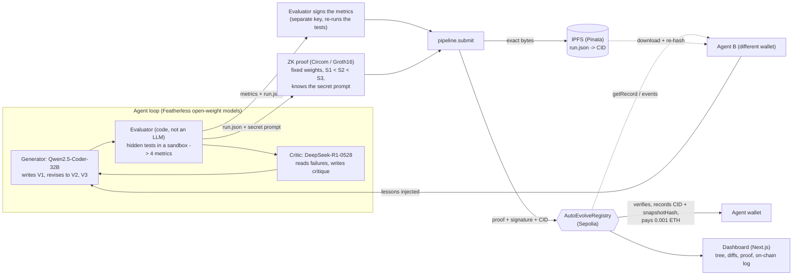

# 🚀 CBIT Hacktoberfest '26 — Project Starter Repository

> **Official Public Starter Repository for CBIT Hacktoberfest '26**  
> *Chaitanya Bharathi Institute of Technology (CBIT), Hyderabad*

---

# AutoEvolve Protocol

**A self-improving coding agent whose improvement is proven with zero-knowledge, whose memory lives on IPFS, and whose reward is paid by a smart contract only when the proof, an independent evaluator and the memory commitment all check out. A second agent then reads that memory from the chain and builds on it.**

Team plan and frozen interfaces: [PLAN.md](PLAN.md) · Live status and links: [docs/STATUS.md](docs/STATUS.md) · Per-role explanations: [docs/explain/](docs/explain/)

## What happened on the live testnet (Sepolia)

| | Agent A (record #0) | Agent B (record #1) |
|---|---|---|
| Task | 1 (log parsing) | 3 (log parsing) |
| Score V1 → V2 → V3 | 4150 → 8950 → 9100 | 0 → 7940 → 9100 |
| Memory | none | 3 lessons read from record #0 via the contract + IPFS |
| Reward | 0.001 ETH | 0.001 ETH |
| Transaction | [0xc99167cc…c5f1](https://sepolia.etherscan.io/tx/0xc99167cc2d72cd2192749afc818cd1d6786c76b5cd723b74a9c165a23871c5f1) | [0x5b6812d0…8559](https://sepolia.etherscan.io/tx/0x5b6812d07cdd676a89df14e507671cd15e16bed05d18fd8329e0a517b0d78559) |
| IPFS (run.json) | `bafkreidqcreyvopzy4avc6me5ehgxpswjdpjtqhuldebunhrsbxotnk3km` | `bafkreieyly5jei37m24boalkv3xe2e7qxt43hyiapqyauk4ybs5tfijgbi` |

- **Registry contract:** [`0xF97417eccD3ab2Db4F9787Aba3b4713e082d61D9`](https://sepolia.etherscan.io/address/0xF97417eccD3ab2Db4F9787Aba3b4713e082d61D9) (Sepolia, chain 11155111). Verifier: `0xC3add50f96616Ca68bC93FD7ddaEA280c6DaEf3c`.
- Both IPFS files re-hash to the `snapshotHash` stored on-chain, so anyone can check that the memory was not altered.
- A read-only attack demo (`node zk/cheat_demo.js`) shows 5 cheating attempts rejected by the contract/prover: score going down, forged metrics, stolen proof, double claim, and an agent inventing its own metrics.
- The public files of both runs (never the secrets) are saved in [backup/](backup/).
- Registry state right now: 2 records, 0.008 ETH of reward escrow left (0.01 ETH funded, 0.001 ETH paid per record).

## Links

| What | Link |
|---|---|
| Source code | https://github.com/plvt7002/HFT26-TEAM-54 |
| Registry contract (Sepolia) | https://sepolia.etherscan.io/address/0xF97417eccD3ab2Db4F9787Aba3b4713e082d61D9 |
| Record #0 run file on IPFS | [public gateway](https://ipfs.io/ipfs/bafkreidqcreyvopzy4avc6me5ehgxpswjdpjtqhuldebunhrsbxotnk3km) · [our Pinata gateway](https://amaranth-written-grasshopper-896.mypinata.cloud/ipfs/bafkreidqcreyvopzy4avc6me5ehgxpswjdpjtqhuldebunhrsbxotnk3km) |
| Record #1 run file on IPFS | [public gateway](https://ipfs.io/ipfs/bafkreieyly5jei37m24boalkv3xe2e7qxt43hyiapqyauk4ybs5tfijgbi) · [our Pinata gateway](https://amaranth-written-grasshopper-896.mypinata.cloud/ipfs/bafkreieyly5jei37m24boalkv3xe2e7qxt43hyiapqyauk4ybs5tfijgbi) |
| Dashboard | runs on the demo laptop at `http://localhost:3000` (see [Run it](#run-it)); it is not hosted publicly |

An IPFS address (CID) identifies the content itself, so the same CID works on any gateway.

## Verify it yourself

No keys needed, only a public Sepolia RPC. This downloads every record's run file from IPFS and checks that its hash equals the `snapshotHash` stored on-chain:

```bash
CHAIN=sepolia RPC_URL=https://ethereum-sepolia-rpc.publicnode.com PYTHONPATH=. python - <<'EOF'
from common.config import get_registry
from common.hashing import keccak, to_field
from pipeline.ipfs import fetch

reg = get_registry()  # address comes from schemas/deployments.sepolia.json
for i in range(reg.functions.recordCount().call()):
    r = reg.functions.getRecord(i).call()  # (taskId, agent, cid, snapshotHash, promptCommitment, scores, timestamp)
    ok = to_field(keccak(fetch(r[2]))) == r[3]
    print(f"record {i}: task {r[0]}, scores {list(r[5])}, IPFS bytes match on-chain hash: {ok}")
EOF
```

## How it works



**One round, in order:**
1. Agent A (Qwen2.5-Coder via Featherless, temperature 0) writes **V1**. The evaluator runs hidden tests in a sandbox; **code turns the results into 4 integer metrics (0-100)**, and the score is `50*tests + 20*edge + 15*lint + 15*simplicity`. An LLM never computes the score.
2. A different model (DeepSeek-R1-0528) critiques the failures; the agent revises to **V2**, then **V3**. Each version must score strictly higher.
3. The evaluator **re-runs the tests and signs the metrics** with its own key (`attest/sign.py`).
4. A **Circom/Groth16 circuit** proves: all metrics are in range, the score uses the fixed pre-committed weights, `S1 < S2 < S3`, and the prover knows the secret system prompt behind a public commitment (the prompt is never revealed). Proof, snapshot hash, wallet and task id are bound together as public signals.
5. `run.json` (code, diffs, critiques, lessons, no secrets) is uploaded to **IPFS** as exact bytes, giving a CID.
6. The **contract** checks, in order: task registered, proof is for this task, proof belongs to the sender, not already claimed, ZK proof valid, evaluator signature valid, escrow funded. Then it records the CID and snapshot hash and **pays the agent**.
7. **Agent B** (a different wallet, no access to A's files) reads the contract, downloads the run from IPFS, re-hashes it against the on-chain value, and injects A's lessons into its own prompt.

## Repository map

| Folder | What | Notes |
|---|---|---|
| [agent/](agent/), [evaluator/](evaluator/), [tasks/](tasks/) | generate-critique-revise loop, Agent B, sandboxed evaluator, 4 frozen tasks with hidden tests | `tasks/t*/tests.json` are hashed on-chain; never edit |
| [zk/](zk/), [attest/](attest/) | Circom circuit, Groth16 keys and verifier, prover, evaluator signing, attack demo | circuit and keys are frozen |
| [contracts/](contracts/) | `AutoEvolveRegistry.sol`, Foundry tests (24) | uses the generated `Groth16Verifier` |
| [pipeline/](pipeline/) | deploy, IPFS, submit, `run_all` | |
| [common/](common/), [schemas/](schemas/) | shared hashing rules and config; addresses, ABI, deployments, example files | everything reads the chain/addresses from here |
| [dashboard/](dashboard/) | live developer dashboard | reads runs and chain read-only |
| [backup/](backup/), [demo/](demo/) | saved public run files and attack results; demo script | fallback if the live demo fails |

## Run it

Linux or WSL2 (Windows users: do everything inside WSL2).

```bash
python3 -m venv .venv && source .venv/bin/activate && pip install -r requirements.txt
cp .env.example .env            # fill in keys; never commit .env
(cd zk && npm install) && (cd dashboard && npm install)

# agent only, no API cost
python -m agent.run --task 1 --agent A --mock-llm

# full flow on the configured chain: agent -> evaluator signs -> ZK proof -> IPFS + on-chain submit
python -m pipeline.run_all --task 1 --agent A
# or continue an existing run folder (sign -> prove -> submit)
python -m pipeline.run_all --run runs/<run_id>

CHAIN=sepolia node zk/cheat_demo.js        # 5 attacks, read-only, zero transactions
(cd dashboard && npm run dev)              # http://localhost:3000
(cd contracts && forge test)               # 24 tests, 9 against the real verifier and a real proof
```

**Dashboard** (`http://localhost:3000`, Next.js; the ☾/☀ button switches dark and light): **Runs** (execution tree, side-by-side diffs, proof panel per run), **On-chain** (registry records and tx links), **Benchmark** (with and without memory, every task including regressions) and **Cheats** (the 5 rejected attacks). It only reads files from the repo and the chain; chain settings go in `dashboard/.env.local` (`CHAIN=sepolia`, `RPC_URL=<public RPC>`, never a key).

**Local fallback (no testnet needed):** start `anvil`, set `CHAIN=local` in `.env`, then `bash pipeline/deploy.sh 1`. The deploy script writes `schemas/deployments.local.json`, the ABI and registers the task hashes. Testnet deploys use `pipeline/deploy_web3.py` (node gas estimates; Foundry's gas simulation does not match Sepolia's current gas schedule).

Chain and addresses are never hardcoded: they come from `.env` (`CHAIN`) and `schemas/deployments.<CHAIN>.json`.

## Trust model (what we claim, said honestly)

- The ZK proof guarantees: the metrics are in range, the score uses the fixed pre-committed weights, S1 < S2 < S3, and the prover knows the secret system prompt behind the public commitment.
- The evaluator signature guarantees: those metrics came from the named evaluator (who re-ran the hidden tests), not from the agent.
- The contract guarantees: proof + signature + memory commitment (snapshotHash) are checked; no replays; no proof theft; reward is paid automatically.
- NOT guaranteed: that the LLM behaved honestly, or that the evaluator is honest (it is a named trust assumption). Tests run in a sandbox but are not proven in ZK. Future work: TEE or zkVM execution of tests, and multiple independent evaluators.

## Honest limits

- **Memory does not reliably raise scores.** Benchmark (one sample per task, temperature 0): average V1 went from 8383 without memory to 6080 with memory. Per task, the change in V1 with memory was +240 (task 2), 0 (task 3: V1 with memory scored 0 because of a regex syntax error from the model) and +500 (task 4). Tasks 2 and 4 with memory start so high that a strictly increasing V1 < V2 < V3 could not be proven (the task-4 run ended `failed_no_improvement` and was not submitted). What *is* demonstrated is the mechanism: Agent B read record #0 from the chain, verified it against IPFS, and used its lessons; its improvement on task 3 came from the critic's feedback.
- **Trusted setup was run entirely by us, one contributor per phase.** The public Hermez "Powers of Tau" file returned HTTP 403, so we generated phase 1 ourselves with snarkjs and then ran phase 2 for our circuit. Same maths and formats as the official route, weaker trust: whoever kept the secret randomness could in theory forge proofs. Fine for a hackathon demo; production would use the public Hermez ceremony plus a multi-party phase 2 (details in [docs/explain/p2.md](docs/explain/p2.md)).
- **Single named evaluator** and non-ZK test execution (see Trust model).
- Testnet only; all keys are throwaway.

## Team

Team Coding Brigaders (TEAM-54). Team members are listed below. Each role has a plain-English explanation in [docs/explain/](docs/explain/) and its full brief in [docs/roles/](docs/roles/).

**Who built what**

- **Agent engineer (P1):** the generate-critique-revise loop with two separate open-weight models, the sandboxed evaluator that turns hidden-test results into the 4 metrics, the 9 tasks with hidden tests (1-4 frozen on-chain), Agent B (reads on-chain memory) and the benchmark. Details: [docs/explain/p1.md](docs/explain/p1.md).
- **ZK + attestation (P2):** a Circom/Groth16 circuit proves metrics are in range, scores use fixed weights and strictly rise V1<V2<V3, and the prover knows the secret prompt behind a public commitment; the contract verifies it on-chain. A separate evaluator re-runs the hidden tests and signs only the numbers it reproduces (`attest/sign.py`). `bash zk/run_cheats_local.sh` rehearses 5 cheating attacks on local Anvil, and `CHAIN=sepolia node zk/cheat_demo.js` re-runs them read-only against Sepolia (0 transactions). Details: [docs/explain/p2.md](docs/explain/p2.md).
- **Integrator, contracts, repo (P3):** `AutoEvolveRegistry.sol` (7 ordered checks, 24 Foundry tests), the Sepolia deployment, the IPFS upload/fetch, `pipeline.submit` and `pipeline.run_all`, shared hashing rules, and the merges.
- **Dashboard and demo (P4):** the live developer dashboard (runs, execution tree, diffs, proof, on-chain log, benchmark, cheats) and the demo script. Details: [docs/explain/p4.md](docs/explain/p4.md).

---

## 📋 Team Information

| Attribute | Details |
| :--- | :--- |
| **Team Name** | **Coding Brigaders** |
| **Team Number** | `TEAM-54` (`HFT26-TEAM-54`) |
| **Registration ID** | `HFEST26-NWESBTK5` |
| **Problem Track** | **Decentralized, ZK-Attested Self-Improving Agent with Immutable Cross-Agent Memory** |
| **Domain** | `General Track` |
| **Team Leader** | Thaswik PLV (thaswik1011@gmail.com) |
| **Institution** | CBIT |

### 👥 Team Members

| # | Name | Email | Institution |
| :--- | :--- | :--- | :--- |
| 1 | Sai Koushik B | kaushikbommasani@gmail.com | CBIT |
| 2 | Paidi Karthik | paidikarthik784@gmail.com | CBIT |
| 3 | Vainyavi Thakur | thakurvainyavi@gmail.com | CBIT |

---

## 🎯 Problem Statement

### **Decentralized, ZK-Attested Self-Improving Agent with Immutable Cross-Agent Memory
**
*Domain:* **Agentic AI, Zero-Knowledge Cryptography & Decentralized Infrastructure**

Current self-improving AI agents operate inside proprietary, isolated runtime environments. When an agent critiques and revises its output, the user has no cryptographic guarantee that the agent didn't hallucinate its improvement score, ignore safety constraints, or delete critical context. Furthermore, learnings from an agent's failure loops are discarded rather than shared across the open-source AI ecosystem. Participants must build AutoEvolve Protocol, an open-source framework where an autonomous agent executes a generate-critique-revise loop (V1V2V3), cryptographically attests to its performance gains using Zero-Knowledge proofs, and publishes immutable execution snapshots to a decentralized storage network for cross-agent collective learning. REQUIREMENTS: 1. Multi-Stage Iterative Agent Engine: Construct an agent loop that generates an initial solution (V1), evaluates its performance against explicit quantitative metrics, and generates refined versions (V2,V3) along with an automated changelog. 2. ZK-Proof of Improvement: Integrate EZKL, Circom, or SP1 to generate a succinct proof () validating that Score(Vn+1)>Score(Vn) based on a pre-committed arithmetic constraint circuit without revealing sensitive system prompts. 3. Decentralized Memory Registry (DataDAO): Upload the execution diffs, critique logs, and memory embeddings to IPFS or Filecoin. Record the resulting IPFS Content Identifier (CID) on an EVM testnet smart contract so other agents can query and inherit the fix history. 4. Smart Contract Verification & Reward Escrow: Deploy an on-chain verifier contract that checks the ZK proof (), verifies the IPFS memory commitment, and distributes micro-rewards to the agent's wallet upon successful verified self-improvement. Open-Source Developer Dashboard: Provide a visual dashboard showing real-time agent execution trees, version diffs, ZK proof verification statuses, and on-chain memory CID logs. EXPECTED OUTCOME: 1. Verifiable Iterative Agent Loop: A functional agent that successfully executes a multi-stage Generate -> Critique -> Revise cycle with a clean automated changelog and measurable performance gains. 2. Cryptographic ZK Proof & On-Chain Settlement: A deployed verifier smart contract on an EVM testnet that successfully validates the ZK proof, records the storage CID, and distributes micro-rewards to the agent's wallet. 3. Cross-Agent Collective Memory: A decentralized DataDAO registry (IPFS/Filecoin) where execution logs and diffs are stored, allowing a second independent agent to query the smart contract, ingest the fix history, and avoid past failure loops. 4. Interactive Developer Dashboard: A visual interface enabling judges and developers to inspect real-time agent execution trees, side-by-side version diffs, ZK verification statuses, and live on-chain logs. Suggested Featherless usage: Adversarial Generator-Critic Separation: Eliminate self-grading bias by routing your agent loop through two distinct, pinned open-weight endpoints via the Featherless API (e.g., using a coding model like Qwen/Qwen2.5-Coder-32B-Instruct for drafting and a reasoning model like deepseek-ai/DeepSeek-R1 as the independent judge). Deterministic Reproducibility for ZK Inputs: Use Featherless serverless endpoints with deterministic parameters (temperature: 0.0) to generate consistent model outputs and exact metadata hashes that can be cleanly referenced in your ZK circuits and IPFS memory payloads.
---

## 🛠️ Contribution & Submission Workflow

All teams must follow the official fork-and-pull-request workflow:

1. **Fork this Repository**:
   - One team member should click the **Fork** button at the top right to fork this upstream repository to your personal/team GitHub account.
2. **Add Collaborators**:
   - In your forked repository, navigate to **Settings > Collaborators** and invite all your registered team members.
3. **Clone & Develop Locally**:
   ```bash
   git clone https://github.com/<your-username>/HFT26-TEAM-54.git
   cd HFT26-TEAM-54
   git checkout -b feature/prototype
   ```
4. **Commit & Push Regularly**:
   - Make atomic, descriptive commits throughout the hackathon.
   ```bash
   git add .
   git commit -m "feat: implement core solution architecture"
   git push origin feature/prototype
   ```
5. **Open Pull Request (PR) for Final Submission**:
   - When ready for evaluation, open a **Pull Request** from your fork's `main` branch back to this upstream repository's `main` branch.
   - **PR Title Format**: `[SUBMISSION] TEAM-54 - Coding Brigaders - Track Selection in Progress`
   - **PR Description Checklist**:
     - 📌 Solution Overview & Approach
     - 🏗️ Architecture & Tech Stack Details
     - 🚀 Local Setup & Installation Instructions
     - 🎥 Demo Video Link / Live Deployment URL
     - 📸 Key Screenshots & Visuals

---

## 📁 Recommended Project Structure

```
.
├── src/                  # Source code (Frontend / Backend / ML)
├── docs/                 # Documentation, architecture diagrams, slides
├── tests/                # Test suites & verification scripts
├── README.md             # Your project documentation & presentation
└── LICENSE               # Open-source license (MIT recommended)
```

---

## ⚠️ Important Rules & Code of Conduct
* **Upstream Protection**: Do not push directly to this repository's main branch. All evaluation will be conducted on your submitted Pull Request.
* **Original Work**: All code submitted must be developed during the hackathon timeline. Open-source libraries and frameworks are welcomed with proper attribution.
* **Code Freeze**: Final Pull Requests must be submitted before the designated hackathon submission deadline.
